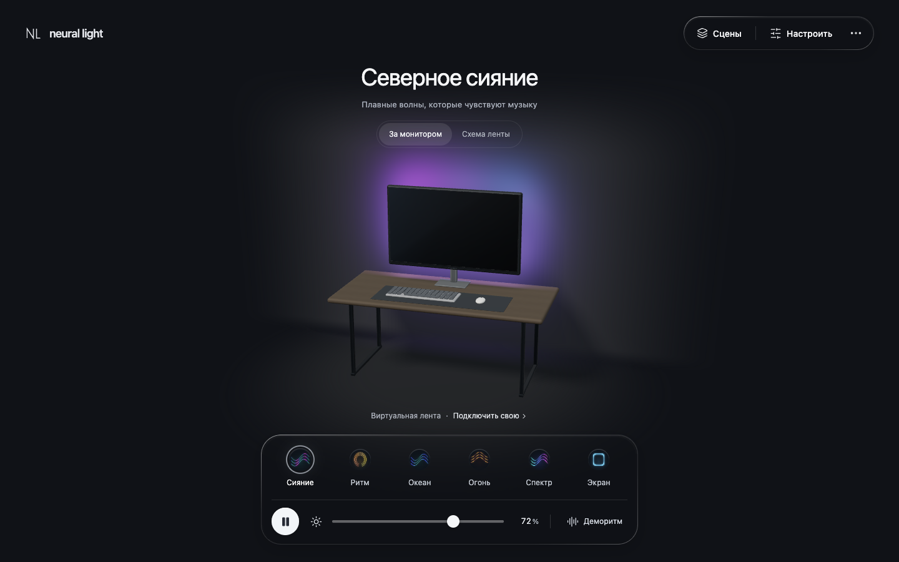

# NEURAL LIGHT

Студия генеративного света для **macOS Apple Silicon + ESP32/WLED**. Нативный движок Swift/Metal, редактор React/TypeScript, локальный WebSocket, передача RGB по DDP и DNRGB.

Рабочая версия **0.1 Preview**. Всё можно попробовать без контроллера: демосигнал проходит настоящий FFT, управляет эффектом и отображается на виртуальной LED-инсталляции. Интерфейс на русском, шрифты и ресурсы включены в сборку, облачных зависимостей нет.

**Серёга, начни с [инструкции для тебя](docs/FOR-SERGEY.md).** Там — установка с нуля, первый запуск, подключение твоей ленты и готовое задание для Codex. Агенту: сначала прочитать [AGENTS.md](AGENTS.md) и [руководство по разработке](docs/DEVELOPMENT.md).



## Запустить

В репозитории находятся **исходники**, примеры и документация. Готовые бинарники и `node_modules` не загружаются. После сборки приложение появится в `build/NEURAL LIGHT.app`. Для запуска уже собранного приложения Node и Xcode не нужны. Требуются macOS 14+ и Apple Silicon. Приложение подписано локальной ad-hoc подписью; для обычного распространения нужен Developer ID и notarization.

Для разработки установите Node.js **22.12+** (ветка 22 указана в `.nvmrc`). Для нативной сборки дополнительно нужны Apple Command Line Tools (`xcode-select --install`) со Swift 5.9+ и macOS SDK 14+. Затем:

```sh
git clone https://github.com/Tikhon00/neural-light.git
cd neural-light
npm ci
npm run dev          # браузерный симулятор: http://127.0.0.1:5173
```

Для автономного приложения на Mac, из той же папки:

```sh
npm run app:build
open "build/NEURAL LIGHT.app"
```

При изменении кода пересоберите приложение и закройте старое окно перед повторным запуском. Браузерный режим с `npm run dev` обновляется автоматически. Полный рабочий цикл, структура модулей и устранение ошибок — в [DEVELOPMENT.md](docs/DEVELOPMENT.md).

1. Выберите сцену в нижней панели и отрегулируйте яркость. Демосигнал уже управляет светом.
2. «Настроить» вверху открывает палитры и скорость. «Тонкая настройка» раскрывает чувствительность к звуку и масштаб волн.
3. «Деморитм» внизу открывает источник звука и кнопку «Послушать»; по умолчанию деморитм не звучит. Микрофон/экран включаются только после выбора источника и разрешения macOS.
4. «Сцены» открывает библиотеку с вашими сценами наверху. «Сохранить текущий свет» добавляет сцену; «Открыть файл» импортирует JSON. Удалённое можно вернуть.
5. «За монитором» показывает пример домашней установки, «Схема ленты» — реальные координаты LED. Переключение вида не меняет выходной свет.
6. «Подключить свою» открывает устройства. Меню «Ещё» содержит экспорт, расположение LED, таймлайн, редактор узлов и диагностику.

Главный экран оставлен свободным: свет и компактное управление в духе Liquid Glass. Редактор адаптируется к размеру экрана iPhone; отдельная iOS-сборка не входит в проект.

Пауза останавливает движение и таймлайн; реакция света на текущий звук остаётся живой. Яркость 0% полностью гасит вывод. После отключения сетевого вывода WLED возвращается к своему режиму по таймауту.

## Что реализовано

| Часть | Поведение |
|---|---|
| Аудио | FFT 2048, окно Hann, 48 логарифмических полос, RMS, низкие/средние/высокие, spectral-flux onset, адаптивный порог, оценка BPM |
| Источники | Детерминированный демосигнал, AVAudioEngine microphone, ScreenCaptureKit screen + system audio; Web Audio/getDisplayMedia в браузере |
| Эффекты | Северное сияние, В ритме, Спектр, Живой огонь, Глубокий океан, За экраном |
| Рендеринг | Metal compute, проверенное соответствие CPU, автоматический CPU fallback при ошибке GPU, единый таймер 60 Hz |
| Граф | Соединение/удаление/перемещение узлов, выбор эффекта, gain, суммирование до 4 слоёв, проверка типов связей и циклов |
| Таймлайн | Воспроизведение/пауза, переход к фрагменту, редактирование начала и длины, добавление/удаление, зацикленная автосмена |
| Пресеты | 6 примеров, автосохранение, именованная библиотека, JSON export/import с валидацией, сохранение графа |
| Маппинг | Лента, 2D-змейка, четыре 3D-арки, спираль; 1–8192 LED; импорт/экспорт XYZ |
| Предпросмотр | 3D-рабочее место на Three.js/WebGL с реальными цветами кадра, мягкими тенями и материалами; схема координат и автоматический Canvas fallback |
| Контроллеры | До 16 адресов WLED, независимые диапазоны сцены, DDP/4048 и DNRGB/21324, явное включение вывода |
| Перегрузка | Ограниченные очереди, latest-frame-wins, отдельный лимит полосы, 60→30→20 FPS при долгих send completions, постепенное восстановление |
| Синхронизация | Общая последовательность кадров, история 64 кадров, ручная компенсация измеренной задержки 0–500 мс |
| Диагностика | Реальные FPS, время рендера, возраст аудиобуфера в телеметрии, локальный WebSocket RTT, счётчики отправленных/пропущенных кадров |

Браузерная версия работает самостоятельно и не отправляет UDP. Настоящий вывод доступен в `.app` или при явном подключении браузера к нативному движку с его временным токеном.

## Проверить и собрать

```sh
npm test                       # чистое TS-ядро
npm run test:ui                # сценарии пользователя, axe, 320/390/768/1440 px
npm run native:test            # Accelerate, Metal vs CPU, пакеты и политика нагрузки
npm run build                 # production редактор
npm run native:build          # release Swift executables
npm run test:integration      # локальный WebSocket + настоящий UDP loopback
npm run bench                 # TypeScript DSP + эффекты
native/.build/release/neural-light-engine --benchmark
npm run app:build
```

UI-тесты используют установленный Google Chrome. `npm run test:integration` требует предварительного `npm run native:build`, занимает около 20 секунд и временно занимает локальные UDP-порты 4048/21324 и TCP 18742. К реальным устройствам тесты не обращаются.

GitHub Actions проверяет TypeScript-тесты, production web build и сборку `.app` на macOS. UI, Metal и аппаратные проверки запускаются отдельно: hosted runner не гарантирует GPU. Архивы и релизы автоматически не создаются.

На Apple M5 в зафиксированном прогоне: примерно 60 FPS для 240–8192 LED, Metal submission-to-completion p95 до 1,7 мс. Это измерение движка, не физической задержки LED. Полные исходные замеры: [отчёт](docs/BENCHMARKS.md).

## Файлы и дальнейшая работа

- [Архитектура и границы модулей](docs/ARCHITECTURE.md)
- [Подключение WLED и калибровка](docs/WLED.md)
- [Протокол управления и телеметрии](docs/PROTOCOL.md)
- [Результаты и ограничения проверки](docs/BENCHMARKS.md)
- [Сценарий проверки для друга](docs/HARDWARE-CHECK.md)
- [Решения по интерфейсу](docs/DESIGN.md)
- [Разбор удобства и внесённые изменения](docs/UX-REVIEW.md)
- [Выбранные навыки для 3D и освещения](docs/3D-SKILLS-RESEARCH.md)
- `examples/*.json` — шесть переносимых сцен.

Это полноценный работающий прототип, а не сертифицированный концертный контроллер. Физические ESP32, микрофон с выданным разрешением и ScreenCaptureKit на пользовательском контенте ещё не проверены. До аппаратного прогона нельзя обещать задержку «звук → фотон», точную межконтроллерную синхронизацию или отсутствие потерь Wi-Fi. Автообнаружение WLED, RGBW, per-LED screen regions, crossfade фрагментов и автоматический фотодиодный замер пока не реализованы.
