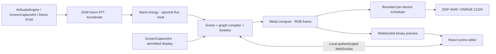

# NEURAL LIGHT / architecture

Local-first macOS 14+ application. Swift/Metal owns the real-time clock; React owns editing. No cloud services or uploads. Browser-only mode implements the same pipeline for an immediately usable simulator.

## First vertical slice

Demo PCM → windowed FFT → adaptive onset detector → Aurora shader → 240 mapped pixels → live simulator. Demo input is deterministic synthesized PCM, not fabricated spectrum telemetry. The browser fallback has a radix-2 FFT and the same effect equations. Real input is opt-in, never activated on launch.

## Boundaries

- `src/engine`: pure browser DSP, scene evaluation, graph compiler, mapping, protocol validation.
- `src/runtime`: audio lifecycle, local/native bridge, frame loop, telemetry. Frames bypass React state; telemetry updates at 10 Hz.
- `src/components`: simulator, spectrum, timeline, graph, inspector, devices. UI changes atomically replace scene snapshots.
- `native/Sources/NeuralCore`: DSP, effect equations, mapping, DDP/DNRGB framing, scheduler policy; unit-testable without devices.
- `native/Sources/NeuralRuntime`: Metal, microphone/screen adapters, local WebSocket, UDP, engine timer.
- `native/Sources/NeuralLightApp`: AppKit/WKWebView shell; React resources included in the `.app`.

## Timing and overload

One monotonic host clock at 60 Hz. Capture callbacks keep only a bounded newest-sample window. At most one GPU frame in flight; late work is skipped rather than queued. A global 64-frame history provides calibrated delays up to 500 ms without scheduling an unbounded queue. Each controller samples that history according to its offset and retains at most one waiting frame. Slow send completions reduce its output rate from 60 → 30 → 20 FPS; recovery is gradual. A configured bandwidth budget caps output before sending. The local preview stays independent of network output.

Every frame is stamped with a sequence number and host monotonic time. Telemetry separates render duration, host audio age, local WebSocket RTT and per-device send/drop counters. UDP completion is **not** confirmation that LEDs displayed a frame. WLED ignores DDP timecodes, so synchronization uses a common frame and calibrated host send offsets; it is best-effort, not hardware genlock. Physical end-to-end latency needs an external photodiode/camera measurement. Manual measured offsets are accepted; an HTTP RTT probe is only a network diagnostic.

## Permissions and control security

AVAudioEngine requests microphone permission only after selecting microphone. ScreenCaptureKit uses the system content picker and requests screen recording permission only on selection. No private APIs, no virtual audio driver. WebSocket listens only on loopback, requires an ephemeral bearer token before commands, bounds input and preview queues, and checks schemas. Token is injected into the native webview; a browser simulator does not silently acquire native control. CLI `--token` is intended for local development/integration tests only.

## Product direction

The redesigned shell is an immersive preview with a single floating control dock. Neutral glass-inspired controls sit above actual light content; secondary settings and professional tools open in accessible dialogs. System macOS/iOS typography with bundled Inter fallback; Russian interface. CSS glass is not Apple's native Liquid Glass material. See DESIGN.md and APPLE-DESIGN-RESEARCH.md for the current rationale and sources.

The first screen answers “What will my light look like now?” Simulator is the default until a real controller is explicitly enabled. All connection states and measurements come from runtime data.
